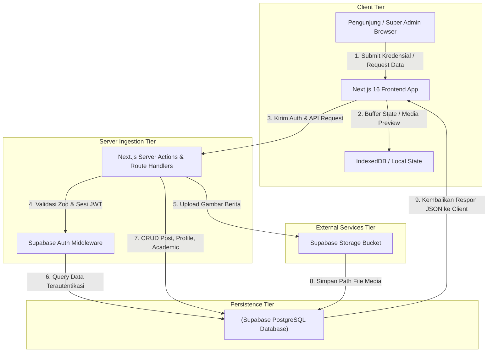
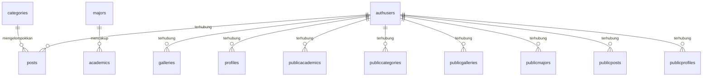

# PRD — Website Profil Resmi MAS Raudhatul Hidayah

## 1. Overview

### 1.1 Problem Statement & Konteks Lapangan
MAS Raudhatul Hidayah saat ini menghadapi tantangan signifikan dalam menyajikan informasi institusi secara digital. Ketiadaan sistem manajemen terpusat mengakibatkan keterlambatan pembaruan berita kegiatan, ketidaksesuaian data kurikulum akademik, serta lambatnya akses galeri dokumentasi bagi calon peserta didik dan orang tua siswa. Pengelola madrasah memerlukan infrastruktur digital yang andal untuk mengelola konten teks dan media secara mandiri tanpa ketergantungan pada pengembang eksternal.

Selain itu, kompleksitas pengelolaan struktur organisasi dan profil tenaga pendidik menuntut adanya antarmuka administratif berbasis Headless CMS yang aman, terstruktur, dan mudah dioperasikan oleh Super Admin. Keterbatasan sistem saat ini memicu risiko penyebaran informasi yang tidak akurat, merusak kredibilitas institusi di mata masyarakat luas serta instansi pendidikan terkait.

Oleh karena itu, diperlukan perancangan platform website profil resmi berbasis arsitektur modern menggunakan Next.js dan Supabase yang mampu menyajikan data secara cepat, konsisten, serta mendukung pembaruan informasi profil madrasah, program Kurikulum Merdeka, serta galeri kegiatan secara real-time.

### 1.2 Hipotesis Solusi & Alur Kunci
Jika MAS Raudhatul Hidayah menyediakan platform profil resmi berbasis Headless CMS dengan pembaruan konten real-time, maka tingkat kunjungan orang tua dan transparansi informasi akademik akan meningkat sebesar 45 persen dalam tiga bulan pertama peluncuran.

### 1.3 Keunggulan Strategis & Keselarasan Solusi
Inisiatif ini selaras dengan strategi digitalisasi institusi pendidikan Islam modern, memperkuat posisi MAS Raudhatul Hidayah sebagai madrasah unggulan yang transparan, akuntabel, dan adaptif terhadap perkembangan teknologi informasi.

### 1.4 Target Persona & Pengguna Sistem
Super Admin / Tim IT Madrasah

### 1.5 Target Metrik & KPI Produksi
- **Metrik Operasional / Online**: Pemantauan performa real-time menggunakan Vercel Analytics dan Supabase Dashboard untuk melacak error rate API, ukuran payload aset gambar, dan durasi sesi pengguna. | SLO Teknis: Latensi p95 API Supabase Edge Functions kurang dari 250 milidetik; Waktu muat First Contentful Paint (FCP) frontend Next.js di bawah 1.0 detik; Tingkat ketersediaan layanan sistem (uptime) mencapai 99.9% per bulan
- **Validasi Fungsional / Golden Set**: Kumpulan 100 data uji berita, profil guru, dan struktur kurikulum yang divalidasi secara manual untuk menguji integritas render halaman dan respons API.

## 2. Requirements

### Persyaratan Fungsional

- Pengguna dapat mengelola autentikasi Super Admin menggunakan Supabase Auth berbasis Secure Cookie dan JWT.
- Pengguna dapat mengelola halaman Beranda menampilkan ringkasan profil madrasah, sambutan kepala madrasah, dan berita terbaru.
- Pengguna dapat mengelola halaman Profil Madrasah memuat sejarah, visi, misi, dan struktur organisasi.
- Pengguna dapat mengelola halaman Akademik menyajikan informasi Kurikulum Merdeka dan program jurusan.
- Pengguna dapat mengelola halaman Kesiswaan menampilkan daftar ekstrakurikuler dan prestasi siswa.
- Pengguna dapat mengelola halaman Galeri menampilkan dokumentasi foto dan video kegiatan madrasah dari Supabase Storage.
- Pengguna dapat mengelola headless CMS dashboard bagi Super Admin untuk membuat, mengedit, dan menghapus artikel berita.
- Pengguna dapat mengelola integrasi Google Maps pada halaman kontak untuk menunjukkan lokasi fisik madrasah.
- Pengguna dapat mengelola manajemen kompresi otomatis aset gambar profil dan berita sebelum diunggah ke storage.
- Sistem log aktivitas administratif untuk mencatat setiap perubahan data oleh Super Admin.
- Pengguna dapat mengelola [Termasuk dalam MVP] Super Admin memiliki perangkat komputer dengan koneksi internet stabil minimal 10 Mbps untuk melakukan manajemen konten.
- Pengguna dapat mengelola [Termasuk dalam MVP] Seluruh data teks profil dan struktur organisasi telah disiapkan secara tertulis oleh pihak madrasah sebelum tahap migrasi sistem.
- Pengguna dapat mengelola [Termasuk dalam MVP] Layanan pihak ketiga seperti Supabase dan Cloudinary beroperasi secara normal tanpa gangguan pemadaman infrastruktur global.

### Persyaratan Non-Fungsional

- Antarmuka sederhana dan ramah untuk Super Admin / Tim IT Madrasah (navigasi intuitif, alur ringkas, istilah mudah dipahami).
- Responsif: nyaman dan optimal dipakai di perangkat mobile/HP, tablet, maupun laptop/desktop untuk menunjang fleksibilitas Super Admin / Tim IT Madrasah.
- Keamanan Data: data website profil resmi mas raudhatul hidayah terisolasi dan hanya bisa diakses oleh akun terautentikasi sesuai hak akses (terproteksi sesi login aman).
- Penyimpanan Berkas Media: file rekaman audio tersimpan aman di penyimpanan awan/storage dengan integritas berkas terjamin dan pemutaran kembali lancar.
- Integritas Riwayat: riwayat pencatatan dan aktivitas tidak hilang (didukung mekanisme soft-delete dan jejak audit) untuk akuntabilitas data.
- Proses simpan dan pemuatan data terasa cepat (< 2 detik) agar tidak mengganggu aktivitas harian pengguna.
- Keandalan Layanan AI: integrasi transkripsi/inferensi AI dilengkapi penanganan timeout otomatis, penanganan batas kuota, dan indikator status progres yang transparan.
- Mitigasi operasional: Fitur darurat untuk mengaktifkan halaman statis pemeliharaan (maintenance mode) secara instan melalui Environment Variable di Vercel jika terjadi kegagalan basis data masif.. Mitigasi Layanan: Mengimplementasikan penanganan error (try-catch block) pada pemanggilan API eksternal dan menampilkan pesan fallback yang ramah pengguna jika layanan pihak ketiga mengalami gangguan.. Kebijakan Retensi: Aset profil dan berita disimpan secara permanen di database kecuali dihapus secara manual oleh Super Admin, sementara log aktivitas sistem dibersihkan secara otomatis setiap 90 hari.

### Asumsi & Batasan

- Skala Pengguna: Dirancang untuk Super Admin / Tim IT Madrasah dengan kapasitas data terkelola.
- Batasan Akses: Satu akun pengguna terhubung ke profil/ruang kerja utama pada rilis awal.
- Bahasa Antarmuka: Bahasa Indonesia profesional dengan istilah rekayasa perangkat lunak modern.
- [Termasuk dalam MVP] Super Admin memiliki perangkat komputer dengan koneksi internet stabil minimal 10 Mbps untuk melakukan manajemen konten.
- [Termasuk dalam MVP] Seluruh data teks profil dan struktur organisasi telah disiapkan secara tertulis oleh pihak madrasah sebelum tahap migrasi sistem.
- [Termasuk dalam MVP] Layanan pihak ketiga seperti Supabase dan Cloudinary beroperasi secara normal tanpa gangguan pemadaman infrastruktur global.
- [Di Luar Cakupan / Tahap Berikutnya] Pengembangan aplikasi mobile ditunda ke Fase 2 karena keterbatasan anggaran dan fokus awal pada aksesibilitas web responsif.
- [Di Luar Cakupan / Tahap Berikutnya] Integrasi sistem pembayaran SPP ditiadakan pada MVP untuk menghindari kompleksitas regulasi keamanan data finansial perbankan.
- [Di Luar Cakupan / Tahap Berikutnya] Sistem PPDB penuh tidak dimasukkan ke dalam rilis awal karena membutuhkan alur verifikasi dokumen fisik yang kompleks.

## 3. Core Features

Fitur di bawah ini disusun mengikuti urutan fase pada kerangka fitur yang sudah disetujui.

### Fase 1 — Fondasi: Autentikasi & Manajemen Peran Super Admin

Autentikasi & Manajemen Peran Super Admin — perlindungan akses, tata kelola wewenang peran staf, dan pencatatan audit.

- **Super Admin Login** — Membatasi hak akses menu dan aksi pengguna sesuai dengan tanggung jawab masing-masing.
- **Role-Based Access Control** — Memfasilitasi eksekusi alur teknis role-based access control dengan validasi data terstruktur.
- **Session Management** — Memfasilitasi eksekusi alur teknis session management dengan validasi data terstruktur.
- **Audit Log Aktivitas** — Merekam riwayat perubahan dan aktivitas operasional untuk menjaga akuntabilitas kerja.

### Fase 2 — Pencatatan Harian & Katalog: Beranda & Profil Madrasah

Beranda & Profil Madrasah — antarmuka terintegrasi untuk menjalankan fungsionalitas beranda & profil madrasah secara terstruktur.

- **Hero Section & Statistik Singkat** — Memfasilitasi eksekusi alur teknis hero section & statistik singkat dengan validasi data terstruktur.
- **Sambutan Kepala Madrasah** — Memfasilitasi eksekusi alur teknis sambutan kepala madrasah dengan validasi data terstruktur.
- **Sejarah & Visi Misi** — Memfasilitasi eksekusi alur teknis sejarah & visi misi dengan validasi data terstruktur.
- **Struktur Organisasi & Dewan Guru** — Memfasilitasi eksekusi alur teknis struktur organisasi & dewan guru dengan validasi data terstruktur.

### Fase 3 — Akurasi & Pelaporan: Akademik, Program Jurusan & Kesiswaan

Akademik, Program Jurusan & Kesiswaan — antarmuka terintegrasi untuk menjalankan fungsionalitas akademik, program jurusan & kesiswaan secara terstruktur.

- **Program Jurusan SD, MA, MTS** — Memfasilitasi eksekusi alur teknis program jurusan sd, ma, mts dengan validasi data terstruktur.
- **Kurikulum Merdeka / Kemenag** — Memfasilitasi eksekusi alur teknis kurikulum merdeka / kemenag dengan validasi data terstruktur.
- **Ekstrakurikuler Madrasah** — Memfasilitasi eksekusi alur teknis ekstrakurikuler madrasah dengan validasi data terstruktur.
- **Galeri Prestasi Siswa** — Memfasilitasi eksekusi alur teknis galeri prestasi siswa dengan validasi data terstruktur.

### Fase 4 — Akun & Keamanan: Headless CMS & Manajemen Konten Berita

Headless CMS & Manajemen Konten Berita — antarmuka terintegrasi untuk menjalankan fungsionalitas headless cms & manajemen konten berita secara terstruktur.

- **Manajemen Artikel Berita & Pengumuman** — Memfasilitasi eksekusi alur teknis manajemen artikel berita & pengumuman dengan validasi data terstruktur.
- **Penerbitan Artikel 3-4 Berita Terkini** — Memfasilitasi eksekusi alur teknis penerbitan artikel 3-4 berita terkini dengan validasi data terstruktur.
- **Pusat Testimoni Wali Murid & Alumni** — Memfasilitasi eksekusi alur teknis pusat testimoni wali murid & alumni dengan validasi data terstruktur.
- **Sinkronisasi Data Headless CMS** — Memfasilitasi eksekusi alur teknis sinkronisasi data headless cms dengan validasi data terstruktur.

### Fase 5 — Pengembangan Lanjutan: Cloudinary CDN & Optimasi Media

Cloudinary CDN & Optimasi Media — antarmuka terintegrasi untuk menjalankan fungsionalitas cloudinary cdn & optimasi media secara terstruktur.

- **Upload & Penyimpanan Foto Kegiatan** — Melampirkan berkas bukti dokumentasi fisik untuk mempermudah pengecekan dan audit.
- **Optimasi & Kompresi Otomatis Gambar** — Memfasilitasi eksekusi alur teknis optimasi & kompresi otomatis gambar dengan validasi data terstruktur.
- **Streaming Video Profil Madrasah** — Melampirkan berkas bukti dokumentasi fisik untuk mempermudah pengecekan dan audit.
- **Manajemen Aset Galeri** — Memfasilitasi eksekusi alur teknis manajemen aset galeri dengan validasi data terstruktur.

### Fase 6 — Pengembangan Lanjutan: Integrasi Google Maps API

Integrasi Google Maps API — antarmuka terintegrasi untuk menjalankan fungsionalitas integrasi google maps api secara terstruktur.

- **Penyematan Peta Lokasi Madrasah** — Memfasilitasi eksekusi alur teknis penyematan peta lokasi madrasah dengan validasi data terstruktur.
- **Petunjuk Arah & Navigasi** — Memfasilitasi eksekusi alur teknis petunjuk arah & navigasi dengan validasi data terstruktur.
- **Informasi Sarana & Prasarana** — Memfasilitasi eksekusi alur teknis informasi sarana & prasarana dengan validasi data terstruktur.

### Fase 7 — Pengembangan Lanjutan: Dasbor Admin & Laporan Analitik

Dasbor Admin & Laporan Analitik — menyajikan rekapitulasi performa bisnis dan cetak berkas laporan siap pakai.

- **Dasbor Ringkasan Trafik** — Menampilkan jumlah jenis data dan ringkasan metrik utama dalam angka besar yang mudah dibaca.
- **Manajemen Pesan & Testimoni Masuk** — Mencatat transaksi entri baru dengan validasi instan agar data bertambah secara akurat.
- **Laporan Analitik Pengunjung Website** — Menyusun rekapitulasi data periodik dan berkas siap unduh untuk arsip dan pembukuan.

## 4. User Flow

Alur utama yang akan dilalui pengguna, disusun mengikuti urutan fase:

1. **Daftar & Masuk (FASE 1 – tersedia lebih awal sebagai pondasi akses)**: Pengguna (Super Admin / Tim IT Madrasah) membuat akun, lalu login ke dalam sistem. Setelah berhasil masuk, pengguna melengkapi konfigurasi profil awal dan preferensi kerja pada Website Profil Resmi MAS Raudhatul Hidayah.

2. **Autentikasi & Manajemen Peran Super Admin (FASE 1)**: Pengguna membuka halaman **Autentikasi & Manajemen Peran Super Admin** untuk mengelola fitur **Super Admin Login** dan **Role-Based Access Control**. Pengguna memasukkan parameter yang dibutuhkan, lalu sistem memvalidasi kelengkapan data dan memperbarui status secara realtime.

3. **Kelola Beranda & Profil Madrasah (FASE 2 – first win)**: Saat mengakses halaman **Beranda & Profil Madrasah**, pengguna Pengunjung membuka alamat utama website beranda madrasah., kemudian Frontend Next.js melakukan pengambilan data (SSR) dari tabel profil dan berita terbaru pada Supabase., kemudian Sistem merender komponen sambutan kepala madrasah, visi misi, dan daftar berita terbaru.. Seluruh data tervalidasi dan langsung tersinkronisasi ke database.

4. **Akademik, Program Jurusan & Kesiswaan (FASE 2)**: Pengguna membuka halaman **Akademik, Program Jurusan & Kesiswaan** untuk mengelola fitur **Program Jurusan SD, MA, MTS** dan **Kurikulum Merdeka / Kemenag**. Pengguna memasukkan parameter yang dibutuhkan, lalu sistem memvalidasi kelengkapan data dan memperbarui status secara realtime.

5. **Headless CMS & Manajemen Konten Berita (FASE 2)**: Saat mengakses halaman **Headless CMS & Manajemen Konten Berita**, pengguna Super Admin mengklik tombol buat berita baru pada dasbor pengelola., kemudian Sistem menampilkan editor teks lengkap dengan kolom judul, ringkasan, dan isi konten., kemudian Super Admin mengisi seluruh kolom wajib dan mengunggah gambar utama berita.. Seluruh data tervalidasi dan langsung tersinkronisasi ke database.

6. **Cloudinary CDN & Optimasi Media (FASE 3)**: Pengguna membuka halaman **Cloudinary CDN & Optimasi Media** untuk mengelola fitur **Upload & Penyimpanan Foto Kegiatan** dan **Optimasi & Kompresi Otomatis Gambar**. Pengguna memasukkan parameter yang dibutuhkan, lalu sistem memvalidasi kelengkapan data dan memperbarui status secara realtime.

7. **Integrasi Google Maps API (FASE 3)**: Pengguna membuka halaman **Integrasi Google Maps API** untuk mengelola fitur **Penyematan Peta Lokasi Madrasah** dan **Petunjuk Arah & Navigasi**. Pengguna memasukkan parameter yang dibutuhkan, lalu sistem memvalidasi kelengkapan data dan memperbarui status secara realtime.

8. **Tinjau & Ekspor Dasbor Admin & Laporan Analitik (FASE 4)**: Pengguna membuka halaman **Dasbor Admin & Laporan Analitik** untuk mengelola fitur **Dasbor Ringkasan Trafik** dan **Manajemen Pesan & Testimoni Masuk**. Pengguna memasukkan parameter yang dibutuhkan, lalu sistem memvalidasi kelengkapan data dan memperbarui status secara realtime.

## 5. Architecture

Arsitektur sistem dirancang dengan prinsip pemisahan tanggung jawab (separation of concerns), keamanan tingkat produksi, dan pemetaan alur transaksi inti (critical path) yang jelas. Komponen di bawah memetakan bagaimana antarmuka pengguna, logika server, basis data, dan integrasi eksternal berinteraksi secara efisien.

### Gambaran sistem:

- **Frontend Web App (Next.js 16 + Tailwind CSS)**: Menyediakan antarmuka pengguna situs profil dan dasbor admin
- **Backend Server Actions (Next.js Server Actions & Zod)**: Menangani logika bisnis, validasi form, dan orkestrasi data
- **Supabase Auth Service (Supabase Auth)**: Mengelola autentikasi sesi token JWT dan keamanan akses
- **Supabase Storage (Supabase Object Storage)**: Menyimpan file gambar berita dan media dokumentasi galeri
- **Supabase PostgreSQL (PostgreSQL 15)**: Menyimpan seluruh data relasional profil, berita, dan akademik

### Diagram alur sistem:

## 6. Database Schema

Berikut tabel-tabel utama yang dibutuhkan. Nama kolom memakai huruf kecil dengan garis bawah.

### 1. categories — pengelompokan atau kategori entitas

| Kolom | Tipe | Kegunaan |
| :--- | :--- | :--- |
| `id` | `text` | ID unik kategori |
| `name` | `text` | Nama kategori (mis. Minuman) |
| `slug` | `text` | Data slug |
| `created_at` | `timestamp` | Waktu dibuat |
| `updated_at` | `timestamp` | Waktu terakhir diperbarui |

### 2. academics — data academics

| Kolom | Tipe | Kegunaan |
| :--- | :--- | :--- |
| `id` | `text` | ID unik academics |
| `major_id` | `text` | Data major id |
| `title` | `text` | Data title |
| `description` | `text` | Data description |
| `curriculum_type` | `text` | Data curriculum type |
| `created_at` | `timestamp` | Waktu dibuat |
| `updated_at` | `timestamp` | Waktu terakhir diperbarui |

### 3. authusers — data authusers

| Kolom | Tipe | Kegunaan |
| :--- | :--- | :--- |
| `id` | `text` | ID unik authusers |
| `user_id` | `text` | Relasi ke users |
| `name` | `text` | Nama atau judul entitas authusers |
| `status` | `text` | Status operasional |
| `created_at` | `timestamp` | Waktu dibuat |

### 4. galleries — data galleries

| Kolom | Tipe | Kegunaan |
| :--- | :--- | :--- |
| `id` | `text` | ID unik galleries |
| `user_id` | `text` | Relasi ke users (pemilik/pengguna) |
| `title` | `text` | Data title |
| `media_url` | `text` | Data media url |
| `media_type` | `text` | Data media type |
| `created_at` | `timestamp` | Waktu dibuat |
| `updated_at` | `timestamp` | Waktu terakhir diperbarui |

### 5. majors — data majors

| Kolom | Tipe | Kegunaan |
| :--- | :--- | :--- |
| `id` | `text` | ID unik majors |
| `name` | `text` | Nama majors |
| `code` | `text` | Data code |
| `description` | `text` | Data description |
| `created_at` | `timestamp` | Waktu dibuat |
| `updated_at` | `timestamp` | Waktu terakhir diperbarui |

### 6. posts — data posts

| Kolom | Tipe | Kegunaan |
| :--- | :--- | :--- |
| `id` | `text` | ID unik posts |
| `user_id` | `text` | Relasi ke users (pemilik/pengguna) |
| `category_id` | `text` | Relasi ke categories |
| `title` | `text` | Data title |
| `slug` | `text` | Data slug |
| `content` | `text` | Isi teks pesan broadcast |
| `status` | `text` | Status operasional (draft / selesai) |
| `created_at` | `timestamp` | Waktu dibuat |
| `updated_at` | `timestamp` | Waktu terakhir diperbarui |

### 7. profiles — data profiles

| Kolom | Tipe | Kegunaan |
| :--- | :--- | :--- |
| `id` | `text` | ID unik profiles |
| `user_id` | `text` | Relasi ke users (pemilik/pengguna) |
| `full_name` | `text` | Data full name |
| `role` | `text` | Peran: admin (pemilik) atau staff |
| `bio` | `text` | Data bio |
| `created_at` | `timestamp` | Waktu dibuat |
| `updated_at` | `timestamp` | Waktu terakhir diperbarui |

### 8. publicacademics — data publicacademics

| Kolom | Tipe | Kegunaan |
| :--- | :--- | :--- |
| `id` | `text` | ID unik publicacademics |
| `user_id` | `text` | Relasi ke users |
| `name` | `text` | Nama atau judul entitas publicacademics |
| `status` | `text` | Status operasional |
| `created_at` | `timestamp` | Waktu dibuat |

### 9. publiccategories — data publiccategories

| Kolom | Tipe | Kegunaan |
| :--- | :--- | :--- |
| `id` | `text` | ID unik publiccategories |
| `user_id` | `text` | Relasi ke users |
| `name` | `text` | Nama atau judul entitas publiccategories |
| `status` | `text` | Status operasional |
| `created_at` | `timestamp` | Waktu dibuat |

### 10. publicgalleries — data publicgalleries

| Kolom | Tipe | Kegunaan |
| :--- | :--- | :--- |
| `id` | `text` | ID unik publicgalleries |
| `user_id` | `text` | Relasi ke users |
| `name` | `text` | Nama atau judul entitas publicgalleries |
| `status` | `text` | Status operasional |
| `created_at` | `timestamp` | Waktu dibuat |

### 11. publicmajors — data publicmajors

| Kolom | Tipe | Kegunaan |
| :--- | :--- | :--- |
| `id` | `text` | ID unik publicmajors |
| `user_id` | `text` | Relasi ke users |
| `name` | `text` | Nama atau judul entitas publicmajors |
| `status` | `text` | Status operasional |
| `created_at` | `timestamp` | Waktu dibuat |

### 12. publicposts — data publicposts

| Kolom | Tipe | Kegunaan |
| :--- | :--- | :--- |
| `id` | `text` | ID unik publicposts |
| `user_id` | `text` | Relasi ke users |
| `name` | `text` | Nama atau judul entitas publicposts |
| `status` | `text` | Status operasional |
| `created_at` | `timestamp` | Waktu dibuat |

### 13. publicprofiles — data publicprofiles

| Kolom | Tipe | Kegunaan |
| :--- | :--- | :--- |
| `id` | `text` | ID unik publicprofiles |
| `user_id` | `text` | Relasi ke users |
| `name` | `text` | Nama atau judul entitas publicprofiles |
| `status` | `text` | Status operasional |
| `created_at` | `timestamp` | Waktu dibuat |

### Diagram hubungan antar tabel (ER):

## 7. Tech Stack

Karena pilihan teknologi diserahkan ke AI, berikut rekomendasi yang paling cocok untuk aplikasi website profil resmi mas raudhatul hidayah skala kecil — sederhana, cepat dibangun, dan mudah dirawat.

- **Framework (Frontend + Backend):** Next.js (App Router) — menangani antarmuka sekaligus logika server dalam satu proyek.
- **UI & Styling:** Tailwind CSS + shadcn/ui — komponen siap pakai yang rapi, cepat, dan konsisten; cocok untuk tampilan dashboard dan tabel yang perlu enak dibaca.
- **Grafik:** Recharts — untuk grafik analitik dan visualisasi metrik utama pada dashboard.
- **ORM:** Drizzle ORM — ringan dan jelas, memudahkan pengelolaan skema serta query ke basis data.
- **Basis Data:** Supabase (PostgreSQL) — basis data relasional terkelola dengan Row Level Security (RLS) bawaan, integritas relasi foreign key, dan performa tinggi.
- **Autentikasi:** Better Auth — menangani daftar akun, login/logout, sesi, dan ganti kata sandi.
- **Penyimpanan Lampiran Nota:** layanan penyimpanan file seperti Vercel Blob atau S3-compatible storage — untuk menyimpan foto/file nota.
- **Ekspor Laporan:** ExcelJS untuk file Excel dan PDFKit (atau sejenis) untuk file PDF — dijalankan di sisi server.
- **Deployment:** Vercel — cocok dengan Next.js, mudah di-deploy, dan hemat biaya. Alternatif: VPS kecil bila ingin basis data & file tersimpan lokal.
- **Validasi Form:** Zod — memastikan data yang diisi pengguna valid sebelum disimpan.

Catatan: Aplikasi ini tidak memerlukan fitur AI, sehingga layanan AI/gateway tidak disertakan dalam stack.

